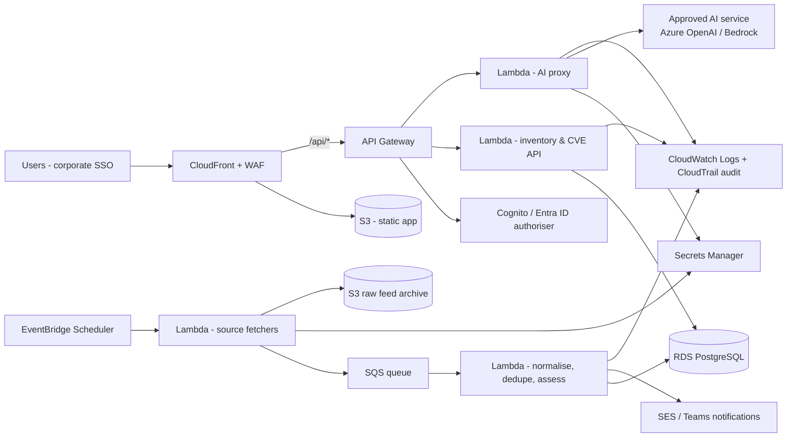

# Vulnerability Management Tool

A web-based tool for maintaining an inventory of applications, infrastructure and software, tracking vulnerabilities (CVEs), and assessing which applications may be affected.

> **Demonstration build.** All records are **fictional sample data** (CVE identifiers use the fictional range `CVE-2099-xxxxx`). There is no authentication and data is stored only in your browser. Do not enter real corporate information until the application has been approved and moved to a secured hosting environment (see [Before production use](#5-what-must-change-before-production-use)).

---

## 1. How the application works

| Section | Purpose |
|---|---|
| **Dashboard** | Headline figures, severity and assessment-status charts, potentially affected applications, investigation priorities, recent CVE activity. |
| **Applications** | Inventory of applications/services: owners, criticality, environments, internet exposure, business function. Expand a row to see infrastructure, AWS accounts and software; open an application for full detail and its vulnerability findings. |
| **Software Inventory** | Each record is vendor + product + **version**. Deployments link software to applications, environments and infrastructure (so different environments can run different versions). Verification status and review dates drive data-quality flags. |
| **Infrastructure** | Deployment targets (EKS/ECS/EC2/ROSA/on-prem OpenShift…), AWS accounts (fictional 12-digit IDs) and a derived cluster view. |
| **Review Queue** | Team members' submissions (Pending review) for analysts to approve, request changes or reject. Submitters cannot approve their own records. |
| **Vulnerabilities (CVEs)** | CVE register: CVSS, affected/fixed versions, exploit and exploitation status, references, remediation. |
| **Impact Assessments** | Cross-reference of every CVE with the inventory: evidence, version check, affected applications/environments/infrastructure/AWS accounts, data-quality gaps, verification steps, rule-based priority, analyst decisions, optional AI assistance. |
| **Monitoring Sources** | Configuration of approved sources (NVD, CISA KEV, vendor advisories), simulated checks using bundled sample feeds, notifications, and the future monitoring architecture. |
| **Reports** | Executive summary, CVE impact, application exposure, data quality, known-exploited CVEs, full inventory workbook — preview, Excel (.xlsx), CSV, print/PDF. |
| **Import / Export** | CSV templates, validated import with preview and duplicate handling, CSV/Excel exports. |
| **Settings** | Organisation settings, AI/monitoring integration endpoints (no keys), notification rules, product aliases, JSON backup/restore/reset, roles, audit log. |

### The assessment engine (and what it does *not* claim)

For each CVE the engine (`js/services/assessment-engine.js`):

1. Matches vendor + product against the software inventory (exact, product-only, or partial), using configurable aliases and optional CPE identifiers.
2. Compares the recorded version with the CVE's affected ranges (`>=2.0.0 <2.17.0 || =1.2.3`, wildcards, OpenSSL letter suffixes, pre-releases).
3. Traces deployments to applications, environments, infrastructure and AWS accounts, distinguishing production from non-production.
4. Lists the evidence for and against, data-quality gaps and the verification still required.
5. Assigns a **rule-based** investigation priority (P1–P4) and shows the rule that fired.

| Status | Meaning |
|---|---|
| Confirmed affected | Set **only by an analyst**, with recorded rationale. |
| Potentially affected | Vendor & product match and version is in an affected range. |
| Requires investigation | Vendor differs, product only partially matches, or the CVE lacks version data. |
| Unable to determine | Product matches but no usable version is recorded. |
| Not affected | Version outside all affected ranges, or an analyst decision. |

A match is a reason to investigate, never proof. No probabilities or confidence percentages are produced. Analyst decisions are flagged for re-review if the CVE changes afterwards. AI output (when enabled) is labelled advisory and never changes a status.

---

## 2. How to run and publish it

### View it locally
ES modules require a web server (opening `index.html` directly from disk will not work in Edge/Chrome).

```bash
python3 -m http.server 8080      # or: npm start
# then open http://localhost:8080
```

### Publish with GitHub Pages
1. Merge this work into `main` (open a pull request from the development branch; if the repository has no `main` branch yet, create it from this branch).
2. In the repository on GitHub: **Settings → Pages → Build and deployment → Source: Deploy from a branch → Branch: `main` / `/ (root)` → Save**. (Any branch can be selected, e.g. to preview the development branch.)
3. After a minute the site is available at `https://<owner>.github.io/<repository>/` (for this repository: `https://robdoyle2.github.io/CVE/`).
4. No build step is needed; `.nojekyll` makes Pages serve files as-is.

> Pages sites published from public repositories are publicly accessible. Keep to fictional data.

### Run the tests
```bash
npm test                 # unit tests (Node 18+; no dependencies)
npm run test:e2e         # browser tests (requires Playwright + Chromium)
node tests/perf/scale.mjs 400 3000 2000   # performance check with synthetic data
```
GitHub Actions (`.github/workflows/ci.yml`) runs both test suites on every push.

---

## 3. How to manage the data

* **Where it lives:** in this browser's `localStorage` (one JSON snapshot). Colleagues do not see your changes, and clearing browser data removes them.
* **Sharing / moving:** Settings → Data management → *Download JSON backup*; another user restores it. Backups are fully validated before restore.
* **Bulk loading:** Import / Export → choose a type → download the template → fill it in → upload → review the validation preview → confirm. Supported: applications, software (with application links), vulnerabilities, infrastructure, AWS accounts, deployments.
  * Lists use `;` (e.g. `Production; Test`), booleans `yes/no`, dates `YYYY-MM-DD`.
  * Duplicates are detected by ID, by natural key (application name; vendor+product+version; CVE ID; AWS account number) and within the file. Choose *skip* or *update*; when updating, empty cells leave values unchanged.
  * Nothing is written unless you confirm, and the import is all-or-nothing.
  * Exports re-import cleanly (round trip).
* **Reset:** Settings → Data management → *Reset to sample data*.
* **Demo users:** switch with the selector in the top bar — Administrator, Security Analyst, Contributor (submissions go to review), Viewer (read-only). This is a demonstration of the workflow, **not** security.

---

## 4. How to add new features

```
index.html            Shell, CSP
css/                  variables.css (design tokens), layout, components, print
js/app.js             Navigation (NAV array) and routing
js/core/              config, store (DataStore + providers), session, router
js/models/            schemas.js (fields, validation, relations), lookups.js (enumerations)
js/data/              Fictional sample dataset
js/services/          Pure logic: version, validation, relationships, assessment-engine,
                      csv, xlsx, data-exchange, reports, ingestion, ai-service, workflow
js/ui/                dom helpers, components, table, form, modal, toast, icons
js/views/             One module per page
data/sample-feeds/    Fictional NVD / CISA KEV feed samples
tests/unit/           node:test unit tests
tests/e2e/            Playwright smoke + workflow tests
docs/                 ARCHITECTURE.md, DATA_MODEL.md, REVIEW.md
```

* **New field on an entity:** add it to `js/models/schemas.js` — forms and validation pick it up automatically. Add it to the column list in `js/services/data-exchange.js` for CSV, and to the sample data if useful.
* **New entity:** add a schema (+ `RELATIONS` entries) and an empty array is created automatically; write a view module and add it to `NAV` in `js/app.js`.
* **New page:** create `js/views/<name>.js` exporting `render(el, ctx)`; register it in `NAV`.
* **New report:** add an entry to `REPORTS` in `js/services/reports.js` returning `[{ name, rows }]`.
* **New monitoring source type:** write an adapter returning canonical CVE records and register it in `ADAPTERS` in `js/services/ingestion.js`.
* **Rules:** escape all data with `esc()`; keep services free of DOM access; add unit tests in `tests/unit` and a workflow in `tests/e2e/workflows.mjs`.

---

## 5. What must change before production use

Full findings: [`docs/REVIEW.md`](docs/REVIEW.md).

**Blockers**
1. **Authentication and authorisation** — corporate SSO (e.g. Microsoft Entra ID federated through Amazon Cognito), roles from IdP groups, enforced by the API on every request.
2. **Shared, secured database** — replace browser storage (unencrypted, per-user) with Amazon RDS; encryption at rest, backups, point-in-time recovery.
3. **Server-side validation and IDs** — re-use the schema rules in the API; database-generated IDs; optimistic concurrency.
4. **Tamper-evident audit logging** — append-only server-side log (e.g. RDS table + CloudTrail/CloudWatch, optionally S3 Object Lock).
5. **Private hosting** — not a public GitHub Pages site; CloudFront with access restricted to corporate users, CSP and security headers sent as HTTP headers.
6. **Backend for monitoring and AI** — external calls and credentials only server-side (Secrets Manager); AI provider approved by information-security and data-protection teams.
7. **Data approval** — information-governance sign-off before loading corporate data.

**Recommended**: WCAG 2.2 accessibility audit; Firefox/Safari testing; SBOM (CycloneDX/SPDX) and scanner integration for accurate versions; vendor CSAF/OVAL data for back-ported fixes; soft delete and record history; penetration test.

---

## 6. Proposed AWS migration plan

> Nothing has been deployed to AWS. Deployment requires explicit approval.



| Concern | AWS design |
|---|---|
| Hosting | S3 (private bucket, Origin Access Control) behind CloudFront; AWS WAF; security headers via CloudFront response headers policy. |
| API | API Gateway (REST) + Lambda (Node.js reusing `js/services/*` and `js/models/*`). Endpoints mirror `ApiProvider`: `GET/POST /{collection}`, `PATCH/DELETE /{collection}/{id}`, plus `/assessments`, `/import`, `/ai/{task}`. |
| Database | Amazon RDS for PostgreSQL (Multi-AZ, encrypted, automated backups); schema in `docs/DATA_MODEL.md`. |
| AuthN/AuthZ | Cognito user pool federated with corporate IdP (SAML/OIDC); JWT authoriser; role checks in Lambda; least-privilege IAM roles per function. |
| Scheduled monitoring | EventBridge Scheduler per source frequency → fetcher Lambdas (NVD API key in Secrets Manager, rate-limited, incremental by `lastModStartDate`) → SQS → ingestion Lambda (existing adapters/planner) → re-assessment → notifications (SES / Teams webhook). |
| Secure AI | AI proxy Lambda: authenticates user, applies data minimisation (`buildAiRequest`), calls approved provider with key from Secrets Manager, logs prompts/responses for audit, enforces quotas. Optionally private connectivity (VPC endpoints / Bedrock in-account). |
| Audit | Append-only `audit_log` table + CloudWatch Logs; CloudTrail for infrastructure; optional S3 Object Lock archive. |
| Delivery | Infrastructure as code (AWS CDK or Terraform); separate dev/test/prod accounts in the existing AWS Organization; CI/CD from GitHub via OIDC role (no long-lived keys). |

**Phases**
1. *Foundation* – IaC, accounts, CloudFront/S3 hosting of the current build behind SSO (data still fictional).
2. *API & database* – RDS schema, Lambda API, switch `APP_CONFIG.dataMode` to `'api'` using `ApiProvider`; migrate sample data via the JSON backup loader.
3. *Identity* – Cognito + corporate IdP, role enforcement, remove demo user switcher.
4. *Monitoring* – scheduled NVD and CISA KEV ingestion, notifications; then vendor advisories.
5. *AI* – AI proxy with approved provider after security/data-protection review.
6. *Hardening & go-live* – penetration test, accessibility audit, runbooks, information-governance approval, load real data.

---

## Outstanding issues

See [`docs/REVIEW.md`](docs/REVIEW.md). In summary: no authentication; per-browser unencrypted storage; client-side-only validation and audit; Firefox/Safari untested; version comparison cannot detect vendor back-ports; `style-src 'unsafe-inline'` in CSP.
