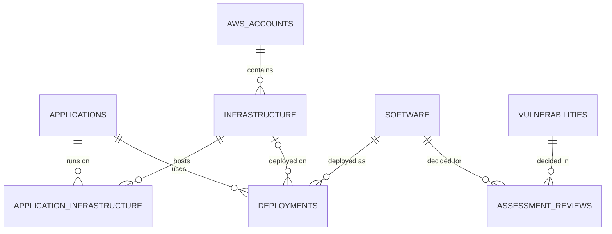

# Data model

The browser build stores data as a JSON snapshot of **normalised collections**. Each collection maps one-to-one to a relational table, and every relationship is held as an ID reference (never by name), so the same structure can be loaded into Amazon RDS for PostgreSQL without redesign.

Field definitions, validation rules and relationships are defined once in [`js/models/schemas.js`](../js/models/schemas.js).

## Entity relationships



### How the many-to-many requirements are met

| Requirement | Design |
|---|---|
| An application runs across several environments and AWS accounts | `applicationInfrastructure` join table → `infrastructure` (one environment, one account, one cluster/namespace each). AWS accounts are *derived* through infrastructure, so they cannot drift out of step. |
| An application uses many software components; a component is used by many applications | `deployments` join table (`applicationId`, `softwareId`). |
| The same application has different versions in different environments | A software record is **vendor + product + version**. Each deployment references the exact version and carries its `environment` (and optionally `infrastructureId`), e.g. Customer Portal uses Tomcat 9.0.80 in Production and 9.0.86 in Staging. |
| Kubernetes / OpenShift | `infrastructure.clusterType`, `clusterName`, `namespace`. Clusters are derived by grouping infrastructure records. |

### Integrity rules (become foreign keys)

| Child | Parent | On delete |
|---|---|---|
| applicationInfrastructure.applicationId | applications | cascade |
| applicationInfrastructure.infrastructureId | infrastructure | cascade |
| deployments.applicationId | applications | cascade |
| deployments.softwareId | software | cascade |
| deployments.infrastructureId | infrastructure | set null |
| infrastructure.awsAccountId | awsAccounts | restrict |
| assessmentReviews.cveId | vulnerabilities | cascade |
| assessmentReviews.softwareId | software | cascade |

Assessment *findings* are **computed**, not stored; only analyst decisions (`assessmentReviews`) are persisted. In AWS the engine output can be materialised into a `findings` table for reporting, refreshed when CVEs or inventory change.

## Proposed PostgreSQL schema (starting point)

```sql
CREATE TYPE environment AS ENUM ('Production','Staging','Test','Development');

CREATE TABLE aws_accounts (
  id            text PRIMARY KEY,
  account_name  text NOT NULL,
  account_id    char(12) NOT NULL UNIQUE CHECK (account_id ~ '^[0-9]{12}$'),
  environment   environment NOT NULL,
  organisational_unit text,
  owner         text NOT NULL,
  notes         text,
  created_at    timestamptz NOT NULL DEFAULT now(),
  updated_at    timestamptz NOT NULL DEFAULT now()
);

CREATE TABLE infrastructure (
  id               text PRIMARY KEY,
  name             text NOT NULL UNIQUE,
  hosting_platform text NOT NULL,
  aws_account_id   text REFERENCES aws_accounts(id) ON DELETE RESTRICT,
  region           text NOT NULL,
  environment      environment NOT NULL,
  cluster_type     text NOT NULL CHECK (cluster_type IN ('None','Kubernetes','OpenShift')),
  cluster_name     text,
  namespace        text CHECK (namespace ~ '^[a-z0-9]([-a-z0-9]*[a-z0-9])?$'),
  owner            text NOT NULL,
  notes            text,
  created_at timestamptz NOT NULL DEFAULT now(), updated_at timestamptz NOT NULL DEFAULT now()
);

CREATE TABLE applications (
  id                text PRIMARY KEY,
  name              text NOT NULL,
  description       text,
  business_owner    text NOT NULL,
  technical_owner   text NOT NULL,
  criticality       text NOT NULL CHECK (criticality IN ('Critical','High','Medium','Low')),
  environments      environment[] NOT NULL,
  internet_facing   boolean NOT NULL DEFAULT false,
  business_function text NOT NULL,
  notes             text,
  submitted_by      text, submitted_date date,
  review_status     text, reviewed_by text,
  last_modified     timestamptz NOT NULL DEFAULT now(),
  created_at timestamptz NOT NULL DEFAULT now(), updated_at timestamptz NOT NULL DEFAULT now()
);
CREATE UNIQUE INDEX applications_name_uq ON applications (lower(name));

CREATE TABLE application_infrastructure (
  id                text PRIMARY KEY,
  application_id    text NOT NULL REFERENCES applications(id) ON DELETE CASCADE,
  infrastructure_id text NOT NULL REFERENCES infrastructure(id) ON DELETE CASCADE,
  UNIQUE (application_id, infrastructure_id)
);

CREATE TABLE software (
  id                  text PRIMARY KEY,
  vendor              text NOT NULL,
  product             text NOT NULL,
  category            text NOT NULL,
  version             text,
  description         text,
  cpe                 text,
  verification_status text NOT NULL,
  last_reviewed       date,
  notes               text,
  submitted_by text, submitted_date date, review_status text, reviewed_by text,
  last_modified timestamptz NOT NULL DEFAULT now(),
  created_at timestamptz NOT NULL DEFAULT now(), updated_at timestamptz NOT NULL DEFAULT now()
);
CREATE UNIQUE INDEX software_natural_uq ON software (lower(vendor), lower(product), lower(coalesce(version,'')));

CREATE TABLE deployments (
  id                text PRIMARY KEY,
  application_id    text NOT NULL REFERENCES applications(id) ON DELETE CASCADE,
  software_id       text NOT NULL REFERENCES software(id) ON DELETE CASCADE,
  infrastructure_id text REFERENCES infrastructure(id) ON DELETE SET NULL,
  environment       environment NOT NULL,
  location          text,
  notes             text
);
CREATE INDEX deployments_software_idx ON deployments (software_id);

CREATE TABLE vulnerabilities (
  id                   text PRIMARY KEY CHECK (id ~ '^CVE-[0-9]{4}-[0-9]{4,}$'),
  title                text NOT NULL,
  description          text NOT NULL,
  published            date NOT NULL,
  last_modified        date,
  cvss_score           numeric(3,1) CHECK (cvss_score BETWEEN 0 AND 10),
  cvss_vector          text,
  severity             text NOT NULL,
  vendor               text NOT NULL,
  product              text NOT NULL,
  affected_versions    text,
  fixed_versions       text,
  "references"         text[],
  exploit_availability text NOT NULL,
  exploitation_status  text NOT NULL,
  remediation          text,
  source               text
);

CREATE TABLE assessment_reviews (
  id          text PRIMARY KEY,
  cve_id      text NOT NULL REFERENCES vulnerabilities(id) ON DELETE CASCADE,
  software_id text NOT NULL REFERENCES software(id) ON DELETE CASCADE,
  status      text NOT NULL,
  rationale   text NOT NULL,
  reviewed_by text NOT NULL,
  reviewed_at timestamptz NOT NULL,
  UNIQUE (cve_id, software_id)
);

-- monitoring_sources, notifications, users (from the identity provider) and an
-- append-only audit_log table follow the same pattern.
```

## Migrating browser data

1. Settings → Data management → **Download JSON backup** (validated snapshot, `schemaVersion` 1).
2. A one-off loader maps each collection to its table (camelCase → snake_case) in dependency order: AWS accounts → infrastructure → applications → links → software → deployments → vulnerabilities → reviews.
3. Run the same validation rules server-side; reject rather than coerce invalid rows.
